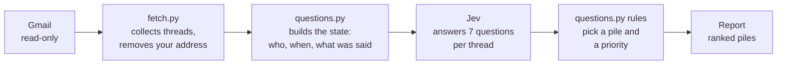

# 1. What Jev is, and why it's different

*About a 10-minute read. No setup needed.*

## The short version

Most AI tools you've used, such as ChatGPT or Claude, are **chat models**. You ask a question and
they **write** an answer: sentences, explanations, drafts, code.

**Jev doesn't write anything.** You give it some information (an email, for example) and a list of
tightly defined questions. For each question, it sends back a **number**:

- *"Is the sender asking you to do something?"* → **0.92** (92% likely yes)
- *"Which of these is the sender: colleague, vendor or stranger?"* → colleague **0.81**,
  vendor **0.15**, stranger **0.04**

Those numbers are something ordinary computer code can act on. That's the whole idea.

TypeSafe, the company behind Jev, calls it a **judgment model**, or a **System One** model. The
name comes from the book *Thinking, Fast and Slow*. "System One" is a quick gut call, and
"System Two" is slow, careful reasoning. Chat models like Claude are System Two. Jev is System One.

## Why software needs this

Every program is full of rules like *"if the order is over $10,000, flag it for review."* Rules
like that only work on things a computer can measure: numbers, dates, checkboxes.

They can't check *"does this email sound urgent?"* or *"is this person waiting on me?"*. Those
aren't numbers. Jev turns them into numbers, so the rule becomes:

> if Jev says the sender is asking me to act (**above 0.7**), put the email in **Reply needed**

The judgment comes from Jev. The decision, *what to do about it*, stays in plain, readable code
that you control.

## What's special about Jev compared with a chat model

| | Chat model (Claude, ChatGPT…) | Jev |
| --- | --- | --- |
| **Output** | Writes text | Returns numbers for the options you define |
| **Making things up** | Can invent an answer | Can only pick from the options you gave it |
| **Consistency** | Wording and answers vary from run to run | Nearly the same answer every time |
| **Speed** | Seconds per answer | A fraction of a second; many questions run in parallel |
| **Cost** | Priced per word in and out | About $0.04 per million words of input; output is free ([current prices](https://docs.typesafe.ai/models.md)) |
| **Good at** | Conversation, reasoning, writing, specialist knowledge | Fast, repeatable judgments in bulk |

### "Calibrated" probabilities

Jev is trained so its numbers mean what they say, like a good weather forecast. When it says
**0.8**, it should be right about 8 times out of 10. That's what makes thresholds work: you
decide how sure Jev must be before your code acts. A number near **0.5** means "can't tell", and
that's useful information too.

### It always picks something

Give Jev three options, and it always returns one of them, even when none fits. So good designs
also ask a separate yes/no question: *"does this email fit any of these categories at all?"*.

## The three kinds of questions

Choose the type by **what your code will do with the answer**:

| If your code needs to… | Use a… | Jev returns | Example |
| --- | --- | --- | --- |
| **act or not act** | **Noul** (yes/no) | the probability of "yes", 0 to 1 | Is the sender asking you to do something? |
| **send it somewhere** | **Choice** | a probability for every option, plus a *confidence* | Who is the sender: supervisor, colleague, vendor…? |
| **sort or rank** | **Score** | a position on a scale you describe in words | How urgent is this: can wait / this week / today? |

(There's a fourth type, **Box**, which finds things in images. This project doesn't use it.)

All the questions for one email go in **one request**, and they run at the same time. Extra
questions cost almost nothing, so it's normal to ask every question about every email, even ones
that might not apply, and let the code ignore the answers it doesn't need.

## Jev and Claude are partners, not rivals

Jev doesn't replace Claude. Each does the job it's built for:

- **Claude** handles conversation, reasoning and writing. In this project, Claude also **writes and
  maintains the code** and helps you design good questions. It uses the TypeSafe *skill*, a
  rulebook about how to work with Jev.
- **Jev** handles the fast, high-volume judgments inside the finished tool: dozens of emails a
  second, each with several questions.

Two common ways to combine them:

1. **Jev in front of or behind Claude:** Jev screens what goes into Claude, or checks what comes
   out (for example, *"does this draft actually answer the question?"*).
2. **Jev instead of Claude for bulk work:** sorting thousands of rows, tagging every ticket, or
   scoring every lead. Claude only gets the few cases Jev wasn't sure about, or the ones that need
   writing.

This project is the second kind.

## How the email tool works

For each email thread, Jev answers questions like these:

- Does the latest message from someone else **ask you** to reply, decide or act?
- Is **your** last message **waiting** on an answer?
- Is there an **unresolved problem** of yours, such as a lost package or a billing dispute?
- Is there a **deadline**? If so, which of the dates in the email is it?
- Was it **written personally** to you, or is it a mass mailing?
- Does it **look like phishing**?
- **Who is the sender** in relation to you?

Then plain code applies the rules. For example: *if it's personal and asks you to act, put it in
**Reply needed***. Then it ranks each pile by how strong the ask is, how close the deadline is,
how long it has waited, and who sent it.

Because the rules are code, not AI, you can read them, test them and change them, and they behave
the same way every time.

## Recommended viewing

The tutorial video **["Jev + Claude = INSANE Results (Every Concept Explained)"](https://youtu.be/D-Z5HnLW_ho)**
by Simon Scrapes covers these ideas with examples, and builds a support-email sorter of its own:

- [0:46](https://youtu.be/D-Z5HnLW_ho?t=46): what a judgment model is
- [3:31](https://youtu.be/D-Z5HnLW_ho?t=211): why it's cheaper, faster and more consistent than chat models
- [6:23](https://youtu.be/D-Z5HnLW_ho?t=383): the yes/no, choice and score question types
- [12:40](https://youtu.be/D-Z5HnLW_ho?t=760): pairing Jev with Claude
- [18:31](https://youtu.be/D-Z5HnLW_ho?t=1111): start from the action, not the data
- [32:13](https://youtu.be/D-Z5HnLW_ho?t=1933): four patterns for getting the most out of Jev

## Learn more

- [TypeSafe documentation](https://docs.typesafe.ai)
- [Question types](https://docs.typesafe.ai/primitives.md) and [patterns](https://docs.typesafe.ai/patterns.md)

**Next:** [2. Install the tools →](02-install.md)
